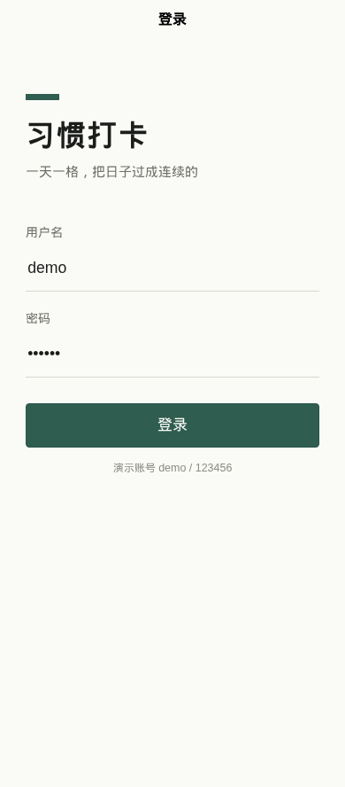
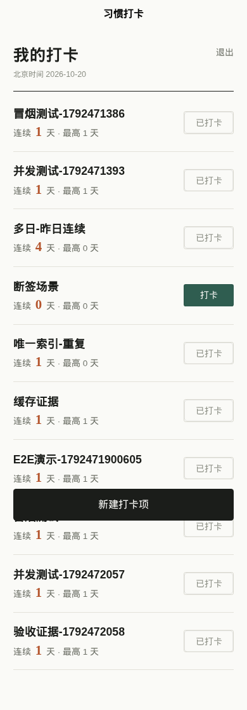
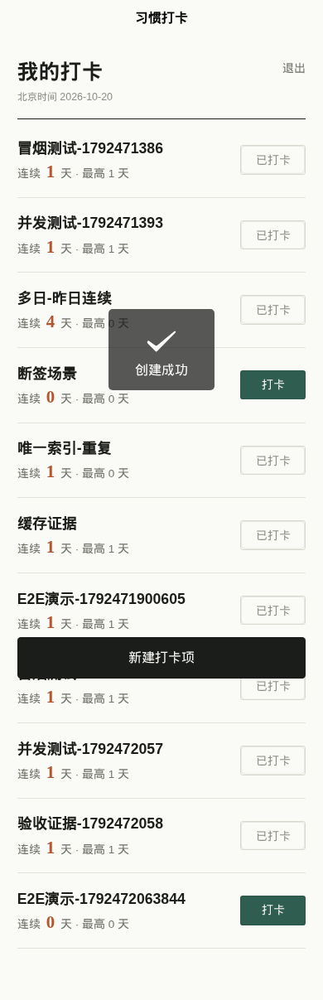
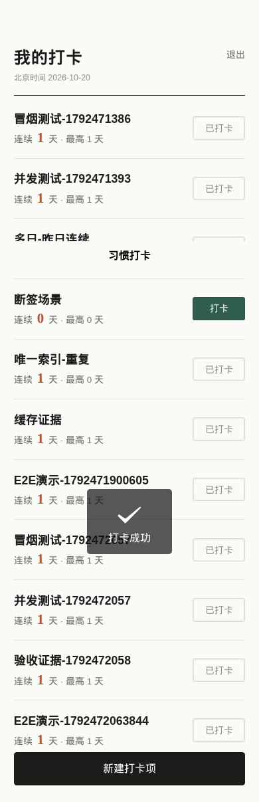
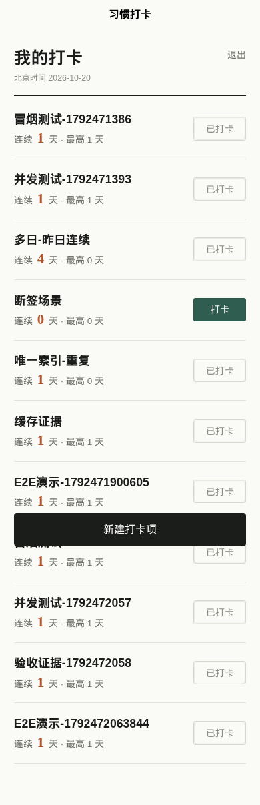

# 验收证据

验证日期：2026-10-20。原始日志：[验收日志.txt](验收日志.txt)；截图目录：[screenshots/](screenshots/)。

## 验证环境

| 项 | 版本 / 说明 |
|---|---|
| Python | 3.10.12 |
| MySQL | 8.0.46（Ubuntu 22.04 包，用户态运行；项目默认由 docker-compose 提供 mysql:8.0） |
| Redis | 6.0.16（项目默认 redis:7-alpine） |
| Node / npm | v22.23.2 / 10.9.8 |
| 浏览器 | Playwright Chromium Headless Shell 156（390×844 视口） |
| 后端端口 | 127.0.0.1:8000 |
| 说明 | 本机验证时 MySQL/Redis 使用 3307/6380 端口（沙箱限制），项目交付配置默认为 3306/6379 |

## 五条红线 → 证据

| 红线 | 证据 |
|---|---|
| 前后端真实联通 | 浏览器 E2E：登录→建项→打卡→刷新后状态仍在→退出；全程无 mock，API 无失败请求 |
| 连续天数正确 | 18 个单元测试全绿（跨月/跨年/闰年/断签/重复/长链）；真实库多日场景：昨天起连续 3 天显示 3，补上今天显示 4，断签显示 0 |
| 并发零重复 | 20 并发：1 个 200 + 19 个 409，`db_record_count=1`；重复插入触发 1062 唯一索引错误 |
| RESTful + 统一返回 | 冒烟 10 步逐条打印 `{code,msg,data}`；HTTP 状态与 code 一致（200/400/401/409）；401 后前端自动跳登录 |
| Redis 可解释 | 4 类 key 均有注释、TTL 与一致性说明；实测 TTL：登录 604800、当日标记到零点、streak 86400 且带 as_of |

## 关键输出摘录

### 1. 单元测试

```
18 passed in 0.31s
```

覆盖用例：今日+前两日、今日未打从昨日算、今日昨日都未打=0、断 1 天停止、跨月、跨年、闰年 2-29、重复日期、首次打卡、乱序输入、100 天长链、日期差反例。

### 2. 全链路冒烟（10 步）

```
[1 登录] HTTP 200 -> code=200
[2 打卡项列表] HTTP 200 -> code=200
[3 创建打卡项] HTTP 200 -> code=200
[4 今日打卡] HTTP 200 -> current_streak=1
[5 重复打卡] HTTP 409 -> code=409
[6 列表] HTTP 200 -> today_checked=true, current_streak=1
[7 查询连续天数] HTTP 200 -> today_checked=true
[8 退出登录] HTTP 200 -> code=200
[9 登出后访问] HTTP 401 -> code=401
[10 无 token 访问] HTTP 401 -> code=401
SMOKE_ALL_PASSED steps=10
```

### 3. 20 并发打卡

```
status_codes=[200, 409, 409, 409, ...]  # 1 个 200，19 个 409
success=1 conflict=19
db_record_count=1
CONCURRENCY_PASSED
```

### 4. Redis TTL 与 Cache Aside 时序

```
login token TTL: 604800
打卡后 check:today:10:20261020 = 1, TTL=39941        # 到北京次日零点
打卡后 streak:10 = '' (已删除), TTL=-2                # 写前删，等读回填
读回填后 streak:10 = {"streak": 1, "as_of": "2026-10-20"}, TTL=86400
```

### 5. 数据库唯一索引兜底

```
ERROR 1062 (23000): Duplicate entry '10-2026-10-20' for key 'check_record.uk_item_date'
```

### 6. 多日场景（真实数据库）

```
昨天起连续 3 天、今天未打 -> current_streak=3, today_checked=false
补上今天               -> current_streak=4, today_checked=true
只有 5 天前一条记录     -> current_streak=0
```

### 7. 参数校验与越权

```
21 字名称 -> HTTP 400 {"code":400,"msg":"参数错误：body.item_name ..."}
其他用户访问 -> HTTP 400 {"code":400,"msg":"打卡项不存在"}
未知路由     -> HTTP 400 {"code":400,"msg":"Not Found"}（统一结构）
```

### 8. H5 构建与浏览器 E2E

```
DONE  Build complete.
login ok, url= http://127.0.0.1:5173/#/pages/index/index
item created: E2E演示-...
check-in ok, streak= 1
reload persistence ok: today_checked=true
logout ok, back to login
console_errors= []
api_failed_requests= []
E2E_ALL_PASSED
```

## 截图

| 步骤 | 截图 |
|---|---|
| 登录页 |  |
| 登录后空列表 |  |
| 新建打卡项 |  |
| 打卡成功（连续 1 天） |  |
| 刷新后仍显示已打卡 |  |
| 退出回登录页 |  |

## 复现命令

```bash
# 后端（已启动、已导入 init.sql）
cd backend
python -m pytest -q
python scripts/smoke.py
python scripts/concurrency_check.py

# 前端
cd frontend
npm run build:h5
npm run dev:h5
# 浏览器打开 http://localhost:5173，demo / 123456
```

说明：本文件中的截图来自真实浏览器会话；测试数据库包含此前验证产生的演示数据（如「冒烟测试-*」「并发测试-*」），不影响结论。需要干净环境时执行 `docker compose down -v && docker compose up -d`。
